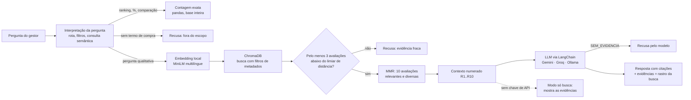
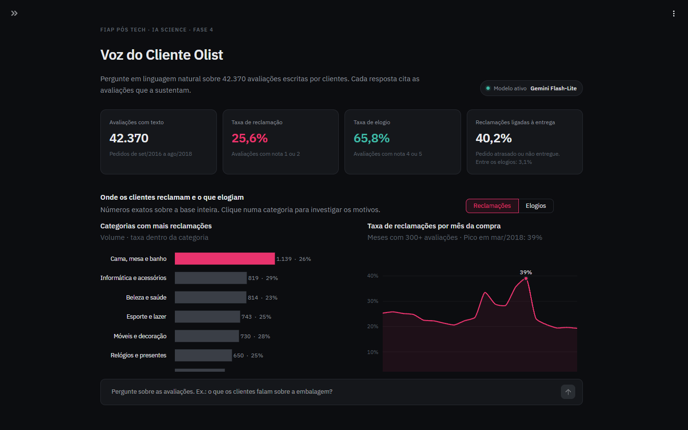
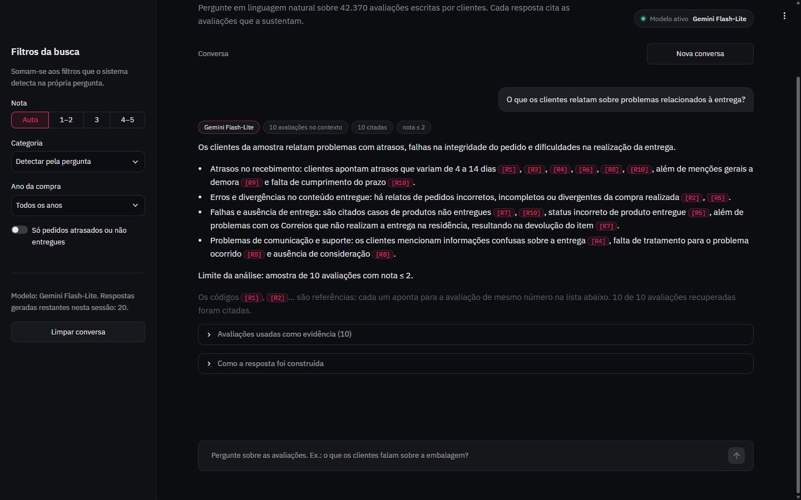
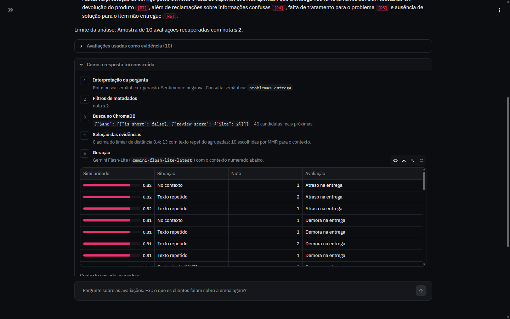

# Voice of Customer Intelligence com RAG · Olist

Tech Challenge da Fase 4 da Pós Tech FIAP em IA Science (1IAST).

Um assistente em que gestores e analistas fazem perguntas em linguagem natural sobre as avaliações de clientes da Olist e recebem respostas **geradas a partir de avaliações reais, com cada afirmação ligada à avaliação que a sustenta**. Quando a base não tem evidência suficiente, o sistema recusa a pergunta em vez de inventar uma resposta.

> **Demonstração online:** [techchallenge4voc-olist.streamlit.app](https://techchallenge4voc-olist.streamlit.app), publicada no Streamlit Community Cloud com o Gemini Flash-Lite. Se o app estiver hibernando, o primeiro acesso leva cerca de um minuto para acordar.

## Sumário

1. [Problema de negócio](#1-problema-de-negócio)
2. [Arquitetura](#2-arquitetura)
3. [Preparação da base de conhecimento](#3-preparação-da-base-de-conhecimento)
4. [Pipeline RAG](#4-pipeline-rag)
5. [Perguntas sem evidência suficiente](#5-perguntas-sem-evidência-suficiente)
6. [Uso de metadados](#6-uso-de-metadados-desafio-adicional)
7. [Avaliação](#7-avaliação)
8. [Exemplos de perguntas e respostas](#8-exemplos-de-perguntas-e-respostas)
9. [Tecnologias e decisões técnicas](#9-tecnologias-e-decisões-técnicas)
10. [Como executar](#10-como-executar)
11. [Estrutura do repositório](#11-estrutura-do-repositório)
12. [Limitações conhecidas](#12-limitações-conhecidas)

---

## 1. Problema de negócio

A Olist tem cerca de 100 mil pedidos avaliados entre 2016 e 2018. A nota (1 a 5) mostra *quanto* o cliente ficou satisfeito, mas o *porquê* está no texto livre: atrasos, produto diferente do anunciado, embalagem, atendimento. Ler 42 mil comentários à mão não escala.

O projeto transforma esses comentários numa base de conhecimento consultável. O gestor pergunta, por exemplo, *"O que os clientes relatam sobre problemas relacionados à entrega?"*, e recebe uma síntese com os temas encontrados, cada um citando as avaliações de origem, que podem ser abertas e conferidas na própria tela.

## 2. Arquitetura



| Camada | Arquivo | Responsabilidade |
|---|---|---|
| Base de conhecimento | `src/preprocessing.py` | Limpeza, cruzamento com pedidos/produtos, metadados |
| Embeddings | `src/embeddings.py` | Vetoriza o texto das avaliações e salva em `data/index/` |
| Banco vetorial | `src/vector_store.py` | Cria a coleção ChromaDB a partir dos vetores salvos |
| Interpretação da pergunta | `src/query_parser.py` | Rota, sentimento, categoria, ano, entrega, escopo, consulta semântica |
| Recuperação | `src/retriever.py` | Busca com filtros, limiar de relevância e MMR |
| Contexto e prompt | `src/prompts.py` | Contexto numerado e regras de fundamentação |
| Modelo de linguagem | `src/llm.py` | Gemini, Groq ou Ollama atrás de uma interface (LangChain) |
| Orquestração | `src/rag_pipeline.py` | Encadeia as etapas e decide quando recusar |
| Números exatos | `src/analytics.py` | Rankings, percentuais e comparações sobre a base inteira |
| Interface | `app.py`, `ui/` | Streamlit: painel, chat, evidências e rastro de cada resposta; `ui/` guarda tema, componentes e gráficos |
| Avaliação | `eval/run_eval.py` | 22 perguntas, ablação de estratégias e relatório |

### Interface

A tela inicial mostra os números que contextualizam as perguntas: 25,6% das avaliações com texto são reclamações, e 40,2% dessas reclamações vêm de pedidos atrasados ou não entregues (contra 3,1% dos elogios). Os gráficos alternam entre reclamações e elogios; clicar numa categoria abre a análise dela no chat.



Cada resposta traz o modelo usado, quantas avaliações entraram no contexto, quantas foram citadas e os filtros aplicados. As citações `[R#]` (R de **referência**) apontam para a avaliação de mesmo número na lista de evidências logo abaixo da resposta.



O painel "Como a resposta foi construída" mostra cada etapa do pipeline: a pergunta interpretada, os filtros, a cláusula enviada ao ChromaDB, cada candidata com sua similaridade e o motivo de ter entrado ou não no contexto, e o texto exato enviado ao modelo.



## 3. Preparação da base de conhecimento

Código: `src/preprocessing.py`. Dados de entrada: os quatro CSVs da Olist em `data/raw/` ([Kaggle](https://www.kaggle.com/datasets/olistbr/brazilian-ecommerce)).

| Decisão | O que foi feito | Por quê |
|---|---|---|
| **Seleção dos dados** | Ficam as avaliações com título **ou** comentário: 42.687 de 99.224 | Nota sem texto não traz evidência qualitativa para o RAG. O título também conta, pois 11,5 mil avaliações têm título, e muitas vezes ele resume a queixa ("Produto errado") |
| **Duplicatas** | 317 `review_id` repetidos (mesma avaliação ligada a mais de um pedido na origem) ficam só na primeira ocorrência: **42.370 documentos** | Evita a mesma evidência aparecer duas vezes no contexto |
| **Limpeza do texto** | Quebras de linha e espaços repetidos viram um espaço; título e comentário são unidos em `review_text` | Mantém o texto original do cliente, que é o que será citado. Não há remoção de acentos nem de stopwords: o modelo de embeddings foi treinado com texto natural |
| **Valores ausentes** | Título ou comentário vazio vira string vazia antes da junção; categoria ausente vira `desconhecido`; pedido não entregue fica com `delivery_status = nao_entregue` e sem atraso calculado | Nenhuma linha é descartada por metadado ausente, só por falta de texto |
| **Pedidos com várias categorias** | 455 pedidos têm itens de categorias diferentes. Fica a categoria do item mais caro, e a flag `has_multiple_categories` registra o caso | A versão anterior pegava a primeira linha do join, de forma arbitrária. O item mais caro é a melhor aproximação de "o produto principal da compra" |
| **Comentários de uma palavra** | 2.982 avaliações como "Ótima", "Péssima", "ok" recebem `is_short = True`: contam nos KPIs, mas nunca viram evidência | Na calibração elas apareciam no topo de quase toda busca curta e não explicam o que aconteceu |
| **Metadados de entrega** | `delivery_status` (no prazo, atrasado, não entregue) e `delivery_delay_days`, calculados a partir da data real e da data estimada de entrega | Permitem filtrar "entregas atrasadas" por fato registrado, e não só pelo que o cliente escreveu |
| **Organização dos documentos** | Um documento por avaliação. Só `review_text` é vetorizado; nota, categoria, datas e entrega viram metadados | Na versão anterior o cabeçalho "Categoria / Nota / Data" ia junto do texto vetorizado, e duas avaliações ficavam "parecidas" por terem a mesma data |

### Embeddings e indexação

- **Modelo:** `paraphrase-multilingual-MiniLM-L12-v2` (384 dimensões), rodando localmente. É multilíngue com bom desempenho em português, leve o bastante para CPU (vetoriza as 42 mil avaliações em cerca de 2 minutos) e não tem custo de API.
- **Banco vetorial:** ChromaDB persistente, distância de **cosseno**. O cosseno dá ao limiar de relevância uma escala fixa (0 = mesmo sentido, 2 = oposto), independente do tamanho dos vetores.
- **Armazenamento:** os vetores ficam versionados em `data/index/embeddings.npy` (float16, 33 MB). O ChromaDB da base inteira passa de 150 MB, acima do limite de 100 MB por arquivo do GitHub. Por isso a coleção é montada a partir dos vetores salvos na primeira execução, em cerca de 30 segundos, e remontada automaticamente se a base mudar (`src/vector_store.py` compara uma assinatura do conteúdo).

## 4. Pipeline RAG

Cada etapa abaixo aparece na interface, no painel **"Como a resposta foi construída"** de cada resposta.

**1. Transformação da pergunta** (`src/query_parser.py`). Regras determinísticas, para que cada decisão possa ser explicada:
- **Rota:** perguntas quantitativas ("quais categorias têm mais reclamações?", "qual a porcentagem…") vão para contagem exata em pandas, sem LLM. Um modelo que lê 10 avaliações não sabe contar 42 mil. Perguntas qualitativas seguem para o RAG.
- **Filtros:** sentimento (reclamação → nota ≤ 2; elogio → nota ≥ 4), categoria (nome ou apelido: "relógio" → `relogios_presentes`), ano da compra e entrega atrasada.
- **Consulta semântica:** a pergunta sem palavras de enquadramento ("quais são os principais…", "os clientes relatam…") e sem o que já virou filtro (categoria, ano, "nota baixa").
- **Escopo:** se a pergunta não menciona nada da experiência de compra, ela é recusada aqui (seção 5).

**2. Recuperação semântica** (`src/retriever.py`). A pergunta original e a consulta semântica são vetorizadas, e a média normalizada é usada na busca. A seção 7 compara as três opções. Os filtros vão **dentro** da consulta ao ChromaDB (`where`), então os vizinhos mais próximos já pertencem ao recorte pedido. Filtrar depois, como fazia a versão anterior, deixava categorias pequenas quase sem evidência.

**3. Seleção dos conteúdos mais relevantes.** Dos 40 candidatos, saem os que têm distância de cosseno acima de **0,40**. Avaliações com texto idêntico (dezenas de clientes escrevem só "Atraso na entrega") viram uma evidência só, anotada com quantas avaliações têm aquele texto. Os restantes são reordenados por **MMR** (Maximal Marginal Relevance, λ = 0,7), que equilibra relevância e diversidade: o contexto cobre temas diferentes em vez de dez variações de "atrasou". Ficam as 10 melhores.

**4. Construção do contexto** (`src/prompts.py`). Cada avaliação entra numerada, com metadados:

```text
[R1] nota 1/5 | categoria: cama_mesa_banho | compra: 2018-03 | entrega: atrasado 6 dia(s)
Entrega atrasada e o produto veio com defeito
```

**5. Geração da resposta** (`src/llm.py`). O prompt de sistema obriga o modelo a:
- citar `[R#]` em toda afirmação;
- não usar conhecimento externo;
- não extrapolar frequências da amostra para a base inteira;
- responder exatamente `SEM_EVIDENCIA` quando as avaliações não respondem à pergunta.

Na interface, cada `[R#]` é destacado, e as avaliações citadas aparecem primeiro na lista de evidências, com nota, categoria, data, status de entrega, similaridade e `review_id`.

> **Como ler as citações `[R#]`.** O "R" vem de **referência**. Antes de chamar o modelo, as avaliações recuperadas são numeradas de R1 a R10 no contexto, e o modelo só pode fazer uma afirmação citando o número da avaliação que a sustenta. `[R7]` aponta para a sétima avaliação da lista "Avaliações usadas como evidência"; `[R2, R5]` indica que a mesma afirmação aparece em duas avaliações. É isso que permite rastrear cada insight até o texto original do cliente (requisito 3 do enunciado). A numeração vale só para aquela resposta: o R1 de uma pergunta não é o mesmo R1 de outra. O identificador permanente de cada avaliação é o `review_id`, mostrado no cartão da evidência.

## 5. Perguntas sem evidência suficiente

São três camadas, da mais barata para a mais cara:

| Camada | Quando age | Exemplo | Custo |
|---|---|---|---|
| **1a. Escopo** | A pergunta não tem nenhum termo da experiência de compra (produto, entrega, atendimento, preço, reclamação, elogio…) nem cita uma categoria | "Qual a capital da França?" | Nenhuma busca |
| **1b. Relevância** | Menos de 3 avaliações ficam abaixo do limiar de distância 0,40 | "Qual o preço do bitcoin hoje?" (o termo "preço" passa pela 1a, mas nenhuma avaliação fala de bitcoin) | Uma busca, sem LLM |
| **2. Modelo** | As avaliações recuperadas não respondem à pergunta, e o modelo responde `SEM_EVIDENCIA` | "Qual foi o lucro líquido da Olist em 2018?" | Uma chamada ao LLM |

Toda recusa diz o motivo: quais filtros foram usados, quantas avaliações passaram e qual era a distância da mais próxima.

A camada 1a existe porque um modelo de embeddings pequeno sempre acha uma avaliação "mais próxima", mesmo para perguntas sem relação. Na calibração, "receita de bolo de chocolate" encontrava a avaliação "Pedi de Baunilha e recebi de CHOCOLATE" a uma distância de cerca de 0,2, menor que a de várias perguntas legítimas. Um limiar sozinho não separa os dois casos.

**Exceção calibrada:** quando a pergunta só expressa sentimento e filtros ("reclamações sobre cama, mesa e banho em 2018"), a consulta semântica fica reduzida a "reclamações". Nesse caso o recorte já define a relevância (nota ≤ 2, categoria e ano) e o limiar de distância não é aplicado.

## 6. Uso de metadados (desafio adicional)

| Metadado | Como é usado | Ganho na recuperação |
|---|---|---|
| Nota (`review_score`) | Reclamação → nota ≤ 2; elogio → nota ≥ 4; filtro manual na barra lateral | Pergunta sobre problemas não recebe elogio como evidência, e vice-versa |
| Categoria | Detectada pelo nome ou apelido, ou escolhida no painel e na barra lateral | Respostas por categoria ("o que elogiam em beleza e saúde?") só com avaliações daquela categoria |
| Período | Ano da compra na pergunta ou na barra lateral; mês exibido no contexto | Permite comparar épocas e situar as evidências |
| Entrega | "entregas atrasadas/insatisfatórias" filtra `delivery_status` atrasado ou não entregue | A evidência vem de pedidos que de fato atrasaram, e não só de quem escreveu "atraso" |

Como os filtros entram no `where` do ChromaDB, a busca roda só dentro do recorte. Isso torna a evidência mais precisa (seção 7) e evita que categorias pequenas fiquem sem resultado.

## 7. Avaliação

`python -m eval.run_eval` roda 22 perguntas fixas (`eval/questions.json`):
- os 5 exemplos do enunciado;
- 4 perguntas do problema de negócio;
- 4 perguntas com metadados;
- 5 perguntas fora do escopo;
- 4 perguntas fora do escopo que usam palavras do domínio.

O relatório completo está em [`eval/RESULTADOS.md`](eval/RESULTADOS.md).

**Resultado com a configuração final** (consulta híbrida, limiar 0,40, `gemini-flash-lite-latest`):

| Métrica | Resultado |
|---|---|
| Perguntas do escopo com evidência suficiente | 13/13 |
| Precisão@5 média (proxy lexical) | 0,92 |
| Perguntas do escopo respondidas pelo LLM com citações | 13/13 |
| Perguntas fora do escopo barradas antes do LLM | 8/9 |
| Perguntas fora do escopo recusadas no total | 9/9 (a 9ª, "lucro líquido da Olist em 2018", foi recusada pelo próprio modelo) |
| Tempo médio de geração | cerca de 2 s |

**Escolha da estratégia de consulta** (precisão@5 / fora do escopo barradas, com o limiar 0,40):

| Consulta vetorizada | Precisão@5 | Fora do escopo barradas | Observação |
|---|---|---|---|
| Pergunta original | 0,74 | 9/9 | Atraída por avaliações que falam "cliente" ou "avaliação"; uma pergunta do escopo fica sem evidência |
| Só a consulta semântica | 0,91 | 8/9 | Literal demais: "insatisfeitos" traz a avaliação de uma palavra "insatisfeito" |
| **Média das duas (escolhida)** | **0,92** | 8/9 | Melhor precisão, mantendo o contexto da pergunta |

**Escolha do limiar:** com 0,35 todas as perguntas fora do escopo são barradas no conjunto de teste, mas sem margem. Uma pergunta legítima formulada de outro jeito cairia fora. Com 0,40 nenhuma pergunta do escopo é perdida, e a pergunta que passa é tratada pelo LLM.

**Sobre a métrica:** precisão@5 aqui é um proxy lexical. Uma avaliação conta como relevante se contém algum radical esperado para a pergunta ("entreg", "atras", "prazo"…). É barata e reproduzível, boa para comparar estratégias, mas não substitui ler as evidências, que é o que a seção 8 mostra.

Testes unitários: `pytest` (29 testes, sem precisar do modelo nem de chave de API).

## 8. Exemplos de perguntas e respostas

Respostas reais geradas por `python -m eval.run_eval --with-llm` com o Gemini Flash-Lite. Os códigos `[R#]` são referências às avaliações listadas na tabela abaixo de cada resposta. As 22 respostas completas, com as avaliações citadas, estão em [`eval/RESULTADOS.md`](eval/RESULTADOS.md#respostas-geradas).

### "O que os clientes relatam sobre problemas relacionados à entrega?"

Filtros detectados: nota ≤ 2.

> Os clientes relatam problemas referentes a atrasos, erros nos itens recebidos, falta de entrega e falhas na comunicação do serviço.
>
> - **Atrasos e descumprimento de prazos:** Há relatos de atrasos que variam de 4 a 14 dias [R1, R3, R4, R6, R8, R10], além de uma menção geral de demora [R9] e reclamações sobre o não cumprimento dos prazos [R8, R10].
> - **Erros e divergências nos itens entregues:** Clientes apontam que os pedidos chegam incompletos, incorretos [R2] ou com divergências em relação à quantidade de produtos recebidos [R5].
> - **Falhas na prestação do serviço pelos Correios e falta de suporte:** É relatado que o produto não foi entregue na residência apesar da taxa paga, resultando na devolução do item antes da retirada [R7], além de reclamações sobre a falta de tratamento e resolução dos problemas de entrega [R8].
> - **Informações confusas:** Um cliente destacou que a informação sobre a entrega é muito confusa [R4].
>
> Limite da análise: amostra de 10 avaliações com nota ≤ 2.

| Ref. | Nota | Avaliação citada |
|---|---|---|
| R5 | 1 | Em partes. Sou cliente há anos, porém sempre há divergências e problemas na entrega, consta como produto entregue, porém foi entregue apenas 1 produto, aguardo … |
| R7 | 1 | O serviço de entrega é feita através dos correios e este apesar de ter sido pega taxa entrega , não entrega na residência.Qdo puder ir fazer a retirada na ag. c… |
| R9 | 1 | Demora na entrega |
| R10 | 1 | Pedido não entregue (prazo de entrega não obedecido) |

Os intervalos de atraso em dias vêm do metadado `delivery_delay_days` que acompanha cada avaliação no contexto, e não do texto do cliente. Avaliações com texto idêntico ("Atraso na entrega" aparece várias vezes) entram uma vez só, com a contagem anotada, para sobrar espaço para outros temas.

### "Quais as reclamações sobre cama, mesa e banho em 2018?"

Filtros detectados: nota ≤ 2, categoria `cama_mesa_banho`, ano 2018.

> As reclamações sobre cama, mesa e banho em 2018 concentram-se em problemas de entrega (atrasos, não recebimento e entregas parciais ou incompletas), falhas no envio dos itens corretos e insatisfação com a qualidade do produto.
>
> - **Problemas de entrega e atrasos:** Clientes relataram atrasos de 6 dias [R5], demora generalizada na entrega [R9] e pedidos que ainda não haviam sido entregues [R3].
> - **Entregas parciais, incompletas ou itens faltantes:** Houve relatos de recebimento de apenas parte dos produtos comprados, como a falta do segundo produto de um pedido [R4], falta do controle remoto da cortina [R8], entrega de apenas uma das duas saias compradas apesar de o rastreio indicar ambas [R10], além de menção genérica a entrega parcial [R8].
> - **Erro no produto enviado:** Um cliente relatou ter recebido um tapete errado e estar aguardando providências [R7].
> - **Baixa qualidade do produto:** Um cliente avaliou as toalhas como muito ruins e finas [R2].
>
> Limite da análise: Amostra de 10 avaliações recuperadas com nota ≤ 2, categoria cama_mesa_banho e ano de compra 2018.

| Ref. | Nota | Avaliação citada |
|---|---|---|
| R2 | 2 | As toalhas muito ruins , finas |
| R7 | 1 | Me entregaram um tapete errado. Estou aguardando providencias |
| R8 | 2 | Entrega parcial .2 mercadoria 1 entrega.me entregarao cortina falta conteole remoto |
| R10 | 1 | APENAS 1. EU COMPREI 2 SAIAS DISTINTAS E SÓ RECEBI UMA. NO RASTREIO, APARECEM ENTREGUES AS DUAS. |

**Recusas**

| Pergunta | Camada | Resposta do sistema |
|---|---|---|
| Qual a capital da França? | Escopo | "Essa pergunta está fora do escopo da base de conhecimento…" |
| Qual o preço do bitcoin hoje? | Relevância | "Não encontrei avaliações suficientes… 0 avaliação(ões) ficaram dentro do limiar de relevância" |
| Como trocar o óleo do carro? | Relevância | Mesmo com o filtro automático da categoria `automotivo`, nenhuma avaliação passa do limiar |
| Qual foi o lucro líquido da Olist em 2018? | Modelo | As avaliações recuperadas falam de custo-benefício; o modelo respondeu `SEM_EVIDENCIA` e o app mostrou a recusa |

**Perguntas quantitativas** (respondidas com contagem exata, sem LLM):
- "Quais categorias têm mais reclamações?" → `cama_mesa_banho` lidera em volume (1.139 reclamações), mas a tabela mostra também a **taxa na categoria**: 26,2%, contra 29,3% de `informatica_acessorios`. Volume e taxa contam histórias diferentes.
- "Sobre informática e acessórios, tem mais gente reclamando ou elogiando?" → 819 reclamações, 247 neutras e 1.730 elogios, com a taxa de reclamação da categoria comparada à da base inteira.

## 9. Tecnologias e decisões técnicas

| Tecnologia | Uso | Por que esta escolha |
|---|---|---|
| Python 3.12 | Linguagem | Compatível com todas as bibliotecas, inclusive PyTorch em CPU |
| pandas | Preparação e contagens exatas | Números reproduzíveis para rankings e KPIs |
| sentence-transformers (MiniLM multilíngue) | Embeddings | Gratuito, local, bom em português, roda em CPU |
| ChromaDB | Banco vetorial | Persistente, sem servidor, com filtros de metadados na própria consulta |
| LangChain (`langchain-core` + integrações) | Camada do LLM | Gemini, Groq e Ollama com a mesma interface, trocados por uma variável |
| Gemini Flash-Lite (padrão) / Groq / Ollama | Geração | As três opções são gratuitas (camada free ou execução local): o projeto não tem custo de API. O Flash-Lite respondeu em cerca de 2 s com a mesma qualidade de citação do Gemini Flash, que levava mais de 1 minuto por resposta na camada gratuita |
| Streamlit + Plotly | Interface | Chat, painel clicável e rastreabilidade sem front-end separado; tema escuro nativo com IBM Plex Sans |
| pytest | Testes | Pipeline testado com embedder, banco e LLM falsos |
| Streamlit Community Cloud (ou Docker) | Publicação | Gratuito, publica direto do GitHub e guarda as chaves como secrets |

**Por que LangChain só na camada do modelo.** O enunciado pede que a equipe *demonstre* a transformação da pergunta, a recuperação e a seleção (pág. 7). Uma chain pronta de recuperação esconderia essas etapas. Por isso a busca, os filtros, o limiar e o MMR estão escritos de forma explícita, e o LangChain fica onde agrega: trocar de provedor de LLM sem mudar o resto do código. A ideia vem da versão anterior do projeto, que já defendia transparência e contagens determinísticas. Ela foi mantida: **números vêm do pandas, texto vem do LLM**.

**Por que um LLM gratuito e trocável.** A geração é a única etapa que usaria API paga. Com o Gemini na camada gratuita como padrão, o Groq como alternativa e o Ollama para rodar localmente, o projeto pode ser reproduzido sem custo. Sem nenhuma chave, o app funciona em **modo só busca**: mostra as evidências que iriam para o modelo.

## 10. Como executar

### Pré-requisitos
- Python 3.12
- Opcional: uma chave gratuita do Gemini ([Google AI Studio](https://aistudio.google.com/apikey)) ou do Groq ([console.groq.com](https://console.groq.com/keys)), ou o [Ollama](https://ollama.com) instalado

### Passo a passo

```bash
git clone https://github.com/NaiaraMartins/1IAST-Tech-Challenge-Fase-4.git
cd 1IAST-Tech-Challenge-Fase-4

python -m venv .venv
# Windows: .venv\Scripts\activate
source .venv/bin/activate

pip install -r requirements.txt   # no Linux já instala o PyTorch só de CPU

# Configurar o LLM (opcional; sem isso o app roda em modo só busca)
cp .env.example .env    # e preencha GOOGLE_API_KEY ou GROQ_API_KEY

streamlit run app.py
```

A primeira execução baixa o modelo de embeddings (cerca de 470 MB) e monta a coleção no ChromaDB (cerca de 30 s). As seguintes abrem direto.

### Recriar a base do zero (opcional)

Os dados processados e os vetores já estão no repositório. Para refazer tudo a partir dos CSVs da Olist:

```bash
python -m src.preprocessing   # data/raw/*.csv -> data/processed/reviews_clean.csv
python -m src.embeddings      # -> data/index/embeddings.npy (cerca de 2 min em CPU)
python -m src.vector_store    # -> data/chroma_db/ (cerca de 30 s)
```

### Testes e avaliação

```bash
pytest                              # 29 testes unitários
python -m eval.run_eval             # recuperação, recusas e ablação
python -m eval.run_eval --with-llm  # também gera as respostas (requer chave)
```

### Configuração

| Variável | Padrão | Descrição |
|---|---|---|
| `LLM_PROVIDER` | `gemini` | `gemini`, `groq` ou `ollama` |
| `LLM_MODEL` | por provedor | `gemini-flash-lite-latest`, `openai/gpt-oss-120b` (Groq) ou `llama3.1:8b` (Ollama) |
| `GOOGLE_API_KEY` / `GROQ_API_KEY` | vazio | Chave do provedor escolhido |
| `OLLAMA_BASE_URL` | `http://localhost:11434` | Só para Ollama |
| `MAX_LLM_CALLS_PER_SESSION` | `20` | Limite de perguntas com geração por sessão (protege a cota gratuita na demonstração pública) |

### Publicação gratuita no Streamlit Community Cloud

1. Entre em [share.streamlit.io](https://share.streamlit.io) com a conta do GitHub dona do repositório.
2. **Create app → Deploy a public app from GitHub**: escolha o repositório, a branch e `app.py` como arquivo principal.
3. Em **Advanced settings**, escolha **Python 3.12** e cole em **Secrets**:

   ```toml
   LLM_PROVIDER = "gemini"
   GOOGLE_API_KEY = "sua-chave"
   ```

4. Clique em **Deploy**. O primeiro build instala o PyTorch só de CPU (o `requirements.txt` já aponta para ele no Linux), baixa o modelo de embeddings e monta a coleção no ChromaDB. Leva alguns minutos.

As chaves ficam nos *secrets* do Streamlit, que viram variáveis de ambiente, e nunca entram no repositório. O app usa cerca de 1,5 GB de memória com a base inteira carregada. Depois de um tempo sem acesso ele hiberna, e o primeiro acesso seguinte demora para acordar. Se a cota gratuita do LLM acabar, o app continua em modo só busca.

**Outras opções:** o `Dockerfile` roda em qualquer serviço que aceite contêineres (porta 7860). O script `scripts/deploy_space.py` publica no Hugging Face Spaces, mas desde 2026 Spaces com Docker no hardware gratuito exigem a assinatura PRO.

## 11. Estrutura do repositório

```text
├── app.py                    # Interface Streamlit
├── ui/
│   ├── theme.py              # Cores, tipografia e nomes de categoria
│   ├── styles.py             # CSS dos componentes e responsividade
│   ├── components.py         # Blocos HTML (indicadores, evidências, rastro)
│   └── charts.py             # Gráficos Plotly com estilo único
├── docs/img/                 # Capturas da interface
├── src/
│   ├── config.py             # Caminhos e constantes
│   ├── preprocessing.py      # Base de conhecimento
│   ├── embeddings.py         # Geração dos vetores
│   ├── vector_store.py       # Coleção ChromaDB
│   ├── query_parser.py       # Transformação da pergunta
│   ├── retriever.py          # Busca, limiar e MMR
│   ├── prompts.py            # Prompt e contexto
│   ├── llm.py                # Provedores de LLM (LangChain)
│   ├── rag_pipeline.py       # Orquestração e recusas
│   └── analytics.py          # Contagens exatas
├── eval/
│   ├── questions.json        # 22 perguntas de avaliação
│   ├── run_eval.py           # Avaliação e ablação
│   ├── RESULTADOS.md         # Relatório gerado
│   └── results/              # Resultados em JSON
├── tests/                    # pytest
├── scripts/deploy_space.py   # Publicação no Hugging Face Spaces (requer PRO)
├── data/
│   ├── raw/                  # CSVs originais da Olist
│   ├── processed/            # reviews_clean.csv (42.370 avaliações)
│   └── index/                # embeddings.npy + ids
├── .streamlit/config.toml     # Tema escuro do app
├── Dockerfile                # Imagem para qualquer serviço de contêiner
├── requirements.txt
└── .env.example
```

## 12. Limitações conhecidas

- **Amostra no contexto:** o LLM lê as 10 avaliações mais relevantes, e não todas. Ele identifica temas, mas não mede a frequência deles; para isso existem as rotas de contagem exata. O prompt proíbe extrapolar percentuais.
- **Interpretação por regras:** a detecção de sentimento, categoria e escopo usa padrões de palavras, o que é transparente mas não cobre todas as formulações. Uma pergunta como "o que poderia melhorar?" pode ser lida como elogio por causa de "melhor".
- **Métrica de precisão:** a precisão@5 da avaliação é um proxy lexical, sem rótulos humanos de relevância.
- **Limiar calibrado em 22 perguntas:** o valor 0,40 foi escolhido com margem, mas num conjunto pequeno.
- **Categoria do pedido:** em 455 pedidos com mais de uma categoria, vale a do item mais caro.
- **Camada gratuita do LLM:** tem limite de requisições. Os provedores aposentam modelos com frequência (durante o projeto, o `gemini-2.5-flash` e o `llama-3.3-70b-versatile` deixaram de estar disponíveis para contas novas). Por isso o padrão do Gemini é o apelido `gemini-flash-lite-latest`, e qualquer modelo pode ser trocado por `LLM_MODEL`.
